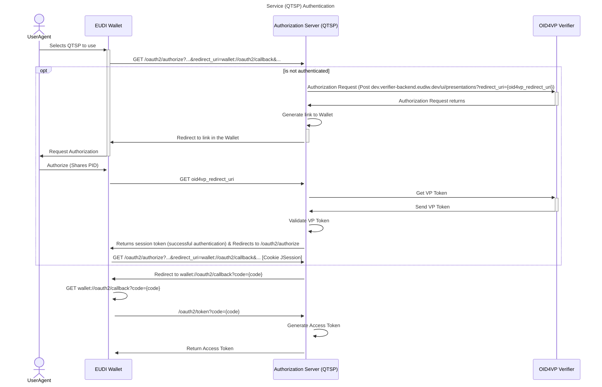
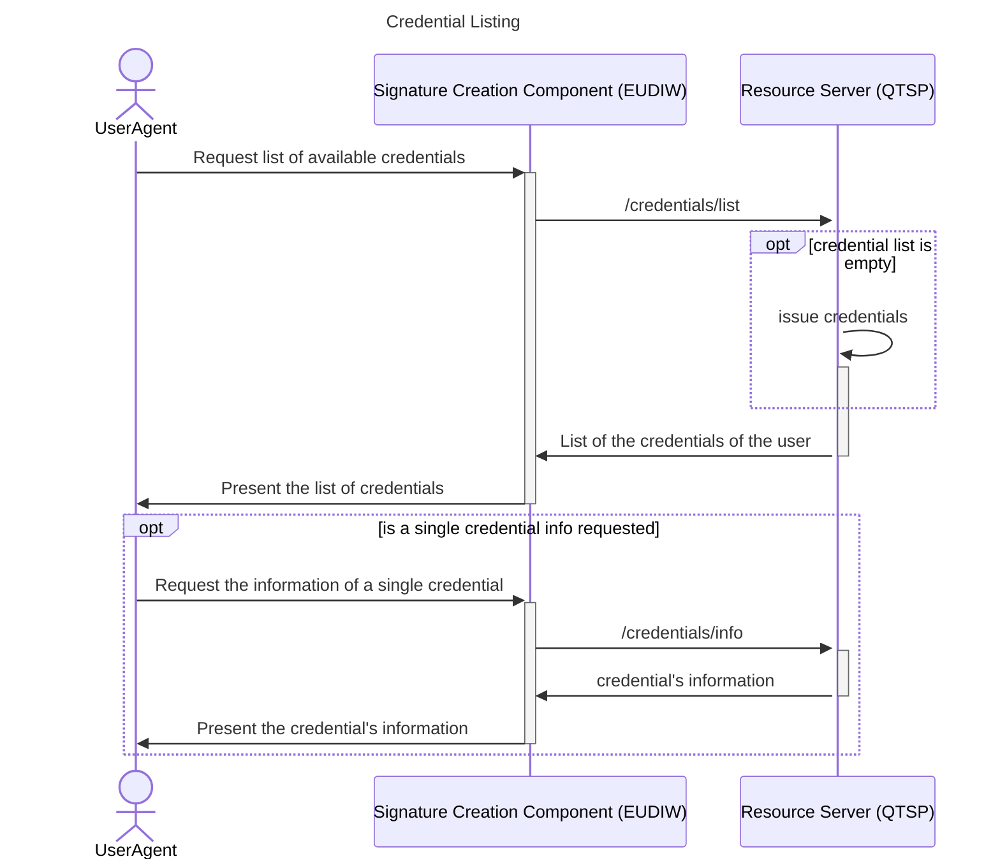
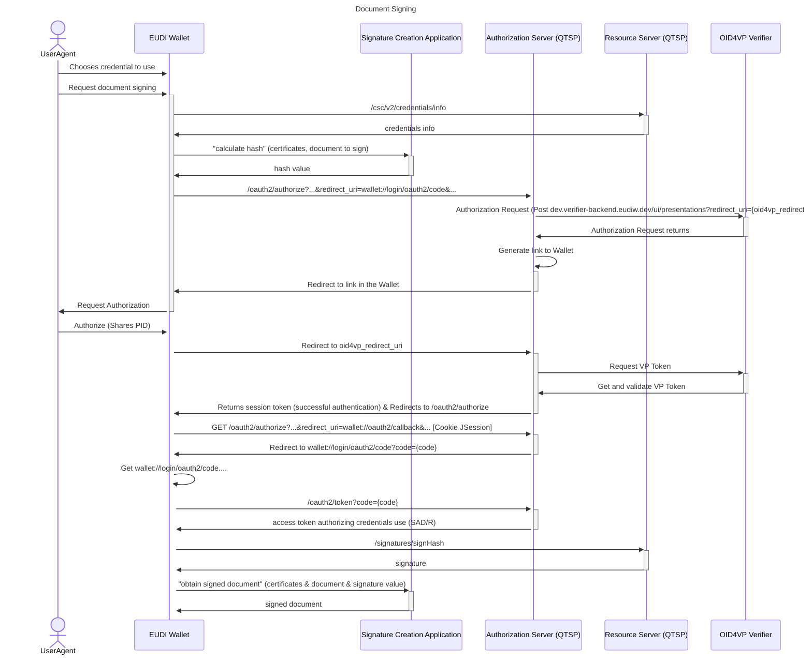
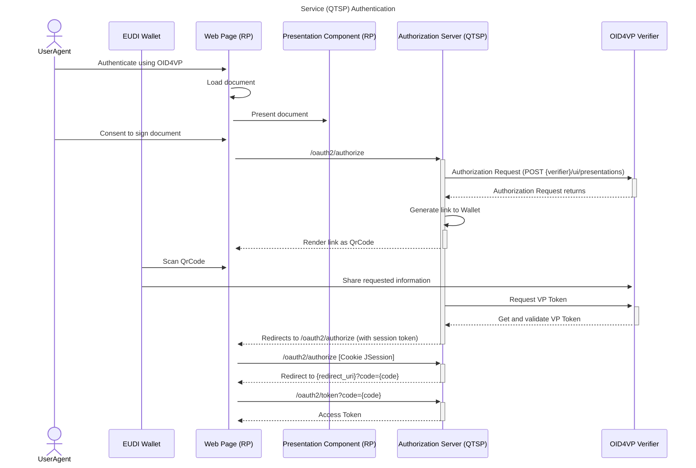
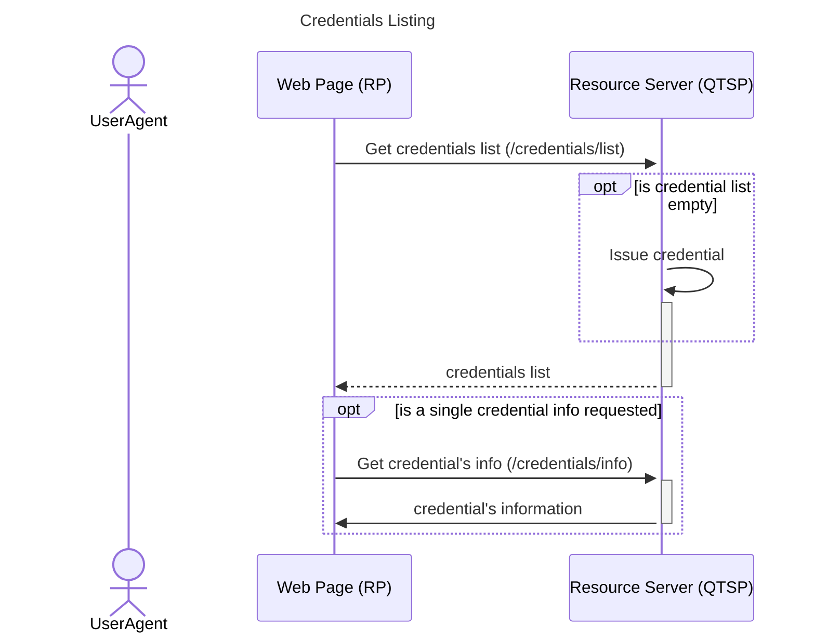
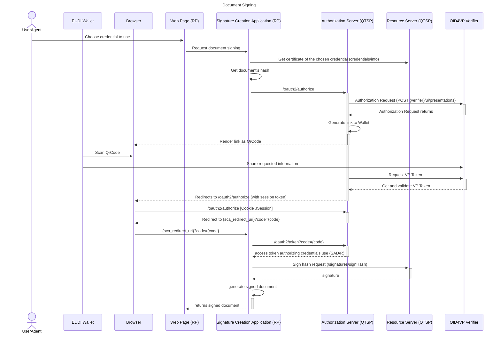

# EUDI Wallet-Driven & RP-Centric signer QTSP

[](https://www.apache.org/licenses/LICENSE-2.0)

:heavy_exclamation_mark: **Important!** Before you proceed, please read
the [EUDI Wallet Reference Implementation project description](https://github.com/eu-digital-identity-wallet/.github/blob/main/profile/reference-implementation.md)

## Table of contents

- [1. Overview](#1-overview)
- [2. Disclaimer](#2-disclaimer)
- [3. Wallet-Driven Sequence Diagrams](#3-wallet-driven-sequence-diagrams)
  - [3.1 Service Authentication](#31-service-authentication)
  - [3.2 Credentials Listing](#32-credentials-listing)
  - [3.3 Credential Authorization](#33-credential-authorization)
- [4. RP-Centric Sequence Diagrams](#4-rp-centric-sequence-diagrams)
  - [4.1 Service Authentication](#41-service-authentication)
  - [4.2 Credentials Listing](#42-credentials-listing)
  - [4.3 Credential Authorization](#43-credential-authorization)
- [5. Endpoints](#5-endpoints)
- [6. Prerequisites](#6-prerequisites)
  - [6.1 Main Variables](#61-main-variables)
  - [6.2 (Optional) EJBCA and HSM](#62-optional-ejbca-and-hsm)
  - [6.3 OAuth2.0 Clients](#63-oauth20-clients)
- [7. Local Deployment](#7-local-deployment)
  - [7.1 Requirements](#71-requirements)
  - [7.2 Database Setup](#72-database-setup)
  - [7.3 Run the Servers](#73-run-the-servers)
- [8. Docker Deployment](#8-docker-deployment)
  - [8.1 Requirements](#81-requirements)
  - [8.2 Configure docker-compose.yml](#82-configure-docker-composeyml)
  - [8.3 Build and Run](#83-build-and-run)
- [9. How to contribute](#9-how-to-contribute)
- [10. License](#10-license)
  - [10.1 Third-party component licenses](#101-third-party-component-licenses)
  - [10.2 License details](#102-license-details)

## 1. Overview

This project provides a RESTful API server that implements a Wallet-Driven and RP-Centric QTSP for the remote Qualified Electronic Signature (rQES) 
in the EUDI Wallet ecosystem. The server follows the CSC API v2.2.0.0 specification and supports OpenID4VP-based authentication.

Currently, the server is running at "https://walletcentric.signer.eudiw.dev", but you can [run it locally](#7-local-deployment) or use the [Docker-based deployment](#8-docker-deployment) option.

The Wallet Centric rQES Specification can be found [here](docs/rqes-walledriven.md).

## 2. Disclaimer

The released software is an initial development release version:

- The initial development release is an early endeavor reflecting the efforts of a short timeboxed
  period, and by no means can be considered as the final product.
- The initial development release may be changed substantially over time, might introduce new
  features but also may change or remove existing ones, potentially breaking compatibility with your
  existing code.
- The initial development release is limited in functional scope.
- The initial development release may contain errors or design flaws and other problems that could
  cause system or other failures and data loss.
- The initial development release has reduced security, privacy, availability, and reliability
  standards relative to future releases. This could make the software slower, less reliable, or more
  vulnerable to attacks than mature software.
- The initial development release is not yet comprehensively documented.
- Users of the software must perform sufficient engineering and additional testing in order to
  properly evaluate their application and determine whether any of the open-sourced components is
  suitable for use in that application.
- We strongly recommend not putting this version of the software into production use.
- Only the latest version of the software will be supported

## 3. Wallet-Driven Sequence Diagrams

### 3.1 Service Authentication



### 3.2 Credentials Listing



### 3.3 Credential Authorization



## 4. RP-Centric Sequence Diagrams

### 4.1 Service Authentication



### 4.2 Credentials Listing



### 4.3 Credential Authorization



## 5. Endpoints

The endpoints presented below are based on the CSC API v2.0 specifications.

- /oauth2/authorize
- /oauth2/token
- /csc/v2/info
- /csc/v2/credentials/list
- /csc/v2/credentials/info
- /csc/v2/credentials/create
- /csc/v2/credentials/delete
- /csc/v2/signatures/signHash

## 6. Prerequisites

All the configuration lives in a `.env` file at the root of the project. Both servers load it at startup, and `docker-compose.yml` passes it to the containers, so you don't need to edit the `application.yml` files.

Start from the sample file:

```bash
cp .env.sample .env
```

Then fill it in as described in the sections below, and define the OAuth2.0 clients in [6.3](#63-oauth20-clients).

### 6.1 Main Variables

| Variable                                                  | Description                                                                                                         | How to get a value                    |
|-----------------------------------------------------------|---------------------------------------------------------------------------------------------------------------------|---------------------------------------|
| `AUTHORIZATION_SERVER`                                    | Public URL of the Authorization Server                                                                              | Default: `http://localhost:8084`      |
| `RESOURCE_SERVER`                                         | Public URL of the Resource Server                                                                                   | Default: `http://localhost:8085`      |
| `SPRING_DATASOURCE_USERNAME`, `SPRING_DATASOURCE_PASSWORD` | MySQL user and password                                                                                            |                                       |
| `SPRING_DATASOURCE_DB_NAME`                               | MySQL database name                                                                                                 |                                       |
| `SPRING_DATASOURCE_DB_URL`                                | MySQL host and port, e.g. `localhost:3306`. Ignored with Docker                                                     |                                       |
| `MYSQL_ROOT_PASSWORD`                                     | Docker only: root password of the MySQL container                                                                   |                                       |
| `MYSQL_HOST_PORT`                                         | Docker only: host port mapped to the MySQL container                                                                | Default: `3306`                       |
| `SYMMETRIC_SECRET_KEY`                                    | Base64-encoded AES key used to encrypt values in the access tokens                                                  | `openssl rand -base64 32`             |
| `DB_ENCRYPTION_PASSPHRASE`                                | Passphrase used to derive the key that encrypts the signing keys stored in the database                             | `openssl rand -base64 32`             |
| `DB_ENCRYPTION_SALT`                                      | Base64-encoded salt used with the passphrase                                                                        | `openssl rand -base64 8`             |
| `VERIFIER-DOMAIN`                                         | Domain of the OpenID4VP Verifier backend                                                                            | Default: `verifier-backend.eudiw.dev` |
| `WALLET-SCHEME`                                           | URL scheme used to open the EUDI Wallet                                                                             | Default: `haip-vp://`                 |
| `INTENDED-USE-ID`                                         | Identifier of the Relying Party intended use configured in the Verifier                                             | Default: `TEST-01`                    |
| `REGISTRATION-CERTIFICATE-JWT`                            | Relying Party registration certificate. If set, it is used instead of `INTENDED-USE-ID`                             |                                       |
| `LOGIN_USER_*`                                            | Docker only, optional: test user for the `login-form` authentication flow, created when the database is initialized |                                       |

At least one of `INTENDED-USE-ID` and `REGISTRATION-CERTIFICATE-JWT` must be set.

> [!WARNING]
> Keep `SYMMETRIC_SECRET_KEY`, `DB_ENCRYPTION_PASSPHRASE` and `DB_ENCRYPTION_SALT` unchanged once the servers are in use. Changing them makes the data already stored unreadable.

### 6.2 (Optional) EJBCA and HSM

The Resource Server can optionally use an HSM to generate and store signing keys, and an EJBCA instance to issue certificates. Each one is enabled independently:

| Variable                 | `true`                                     | `false` (default)                     |
|--------------------------|--------------------------------------------|---------------------------------------|
| `KEYS_USE_HSM`           | Keys are managed by an HSM through PKCS#11 | Keys are generated by the server      |
| `CERTIFICATES_USE_EJBCA` | Certificates are issued by EJBCA           | Certificates are issued by a local CA |

#### 6.2.1 Certificate Issuance

**With EJBCA** (`CERTIFICATES_USE_EJBCA=true`), set the following variables:

| Variable                         | Description                                  |
|----------------------------------|----------------------------------------------|
| `EJBCA_HOST`                     | EJBCA hostname or IP                         |
| `EJBCA_CLIENT_P12_FILEPATH`      | Path to the client `.p12`/`.pfx` certificate |
| `EJBCA_CLIENT_P12_PASSWORD`      | Password of the `.p12` file                  |
| `EJBCA_MANAGEMENT_CA`            | Path to the ManagementCA certificate         |
| `EJBCA_CERTIFICATE_PROFILE_NAME` | Certificate profile name in EJBCA            |
| `EJBCA_END_ENTITY_PROFILE_NAME`  | End entity profile name in EJBCA             |
| `EJBCA_USERNAME`                 | EJBCA API username                           |
| `EJBCA_PASSWORD`                 | EJBCA API password                           |

The CA used for each country is configured in `certificates.ejbca.countries` in [resource_server/src/main/resources/application.yml](resource_server/src/main/resources/application.yml).

**Without EJBCA** (`CERTIFICATES_USE_EJBCA=false`), set the following variables:

| Variable                                   | Description                             | Example                                |
|--------------------------------------------|-----------------------------------------|----------------------------------------|
| `CERTIFICATES_CA_SUBJECT_CERTIFICATE_FILE` | Path to the CA certificate              | `certificates/rootCA.crt`              |
| `CERTIFICATES_CA_SUBJECT_KEY_FILE`         | Path to the CA private key (PKCS#8 DER) | `certificates/rootCA.key`              |
| `CERTIFICATES_CA_SUBJECT_COMMON_NAME`      | CA subject Common Name (`CN`)           | |
| `CERTIFICATES_CA_SUBJECT_ORGANIZATION`     | CA subject Organization (`O`)           | |
| `CERTIFICATES_CA_SUBJECT_COUNTRY`          | CA subject Country (`C`)                | |

If the two files don't exist, the Resource Server creates a new CA at startup and saves it to those paths (the folder must exist). To use your own CA instead, you can create it with OpenSSL:

```bash
mkdir -p certificates

# 1. Generate the RSA key and the self-signed CA certificate
openssl req -x509 -newkey rsa:4096 -nodes -keyout certificates/rootCA.pem \
  -sha256 -days 3650 -out certificates/rootCA.crt \
  -subj "/C={CA_SUBJECT_COUNTRY}/O={CA_SUBJECT_ORGANIZATION}/CN={CA_SUBJECT_COMMON_NAME}" \
  -addext "basicConstraints=critical,CA:TRUE" \
  -addext "keyUsage=critical,keyCertSign,cRLSign"

# 2. Convert the private key to unencrypted PKCS#8 DER, the format the server expects
openssl pkcs8 -topk8 -nocrypt -in certificates/rootCA.pem -outform DER -out certificates/rootCA.key \
  && rm certificates/rootCA.pem
```

The subject values in `.env` must match the `-subj` used to create the certificate.

#### 6.2.2 Key Management

**With an HSM** (`KEYS_USE_HSM=true`), set the following variables. The HSM is accessed through [jacknji11](https://github.com/joelhockey/jacknji11), and this version was tested with the Utimaco vHSM.

| Variable                    | Description                                |
|-----------------------------|--------------------------------------------|
| `CS_PKCS11_R2_CFG`          | Path to the Utimaco PKCS#11 configuration file |
| `JACKNJI11_PKCS11_LIB_PATH` | Path to the PKCS#11 `.so` library          |
| `JACKNJI11_TEST_INITSLOT`   | Initial HSM slot identifier                |
| `JACKNJI11_TEST_TESTSLOT`   | HSM slot used to create the keys           |
| `JACKNJI11_TEST_USER_PIN`   | HSM user PIN                               |

> [!IMPORTANT]
> These variables are read directly from the process environment, not through Spring. When running locally (without Docker), export them in your shell as well, as shown in [7.3](#73-run-the-servers).

**Without an HSM** (`KEYS_USE_HSM=false`), no additional variables are needed.

### 6.3 OAuth2.0 Clients

The OAuth2.0 clients of the Authorization Server are defined in an `application-secret.yml` file (ignored by Git). Place it in `config_files/`. You can define one or more clients:

```yaml
authorizationserver:
  client:
    {client-id}:
      client-id: "{client-id}"
      client-secret: "{noop}{client-secret}"
      client-authentication-methods:
        - "client_secret_basic"
      authorization-grant-types:
        - "authorization_code"
      redirect-uris:
        - "{redirect-uri}"
      scopes:
        - "service"
        - "credential"
      authentication-flow: {authentication-flow}
```

`authentication-flow` must be one of `login-form`, `same-device-flow` or `cross-device-flow`.

## 7. Local Deployment

### 7.1 Requirements

- Java 17
- Apache Maven 3.6.3 or later
- MySQL 8

### 7.2 Database Setup

1. Create the database and the user defined in `.env`:

   ```sql
   CREATE DATABASE {database_name};
   CREATE USER '{database_username}'@'localhost' IDENTIFIED BY '{database_password}';
   GRANT ALL PRIVILEGES ON {database_name}.* TO '{database_username}'@'localhost';
   ```

   If MySQL runs on a different machine, replace `localhost` with the host the servers connect from.

2. Create the Spring Authorization Server tables. The remaining tables are created automatically when the servers start.

   ```bash
   mysql -u {database_username} -p {database_name} < tools/mysql/init/01_oauth2_authorization_server_schema.sql
   ```

3. (Optional) To test the `login-form` flow, replace the placeholders in [tools/add_login_form_user.sql](tools/add_login_form_user.sql) and run it:

   ```bash
   mysql -u {database_username} -p < tools/add_login_form_user.sql
   ```

### 7.3 Run the Servers

From the project root, start the Authorization Server first, because its script also builds the project:

```bash
./tools/deploy_as.sh   # builds the project and starts the AS on port 8084 (logs in nohup_AS.out)
./tools/deploy_rs.sh   # starts the RS on port 8085 (logs in nohup_RS.out)
```

If you use an HSM, export its variables first:

```bash
export $(grep -E '^(CS_PKCS11_R2_CFG|JACKNJI11_)' .env | xargs)
```

## 8. Docker Deployment

`docker-compose.yml` starts MySQL, the Authorization Server and the Resource Server. On the first start (empty data volume), MySQL creates the database, the user and the Spring Authorization Server tables, and the test user if `LOGIN_USER_GIVEN_NAME` is set. `SPRING_DATASOURCE_DB_URL` is set to the MySQL container automatically.

### 8.1 Requirements

- Docker
- Docker Compose

### 8.2 Configure docker-compose.yml

`docker-compose.yml` mounts the following folders from the project root. Create the ones you need, or change the host folder in `docker-compose.yml` if your files are elsewhere:

| Service                | Host folder      | Mounted at                | Contents                                                                                  |
|------------------------|------------------|---------------------------|-------------------------------------------------------------------------------------------|
| `authorization_server` | `./config_files`      | `/opt/app/config/config_files` | `application-secret.yml` (see [6.3](#63-oauth20-clients)). Required                       |
| `resource_server`      | `./certificates` | `/opt/app/certificates`   | Local CA certificate and key, kept across restarts                                        |
| `resource_server`      | `./hsm`          | `/opt/app/config/hsm`     | HSM files, only if `KEYS_USE_HSM=true`                                                    |
| `resource_server`      | `./ejbca`        | `/opt/app/config/ejbca`   | EJBCA client certificate and ManagementCA, only if `CERTIFICATES_USE_EJBCA=true`          |

The paths in `.env` are read inside the containers, so they must use the mounted locations, for example `JACKNJI11_PKCS11_LIB_PATH=/opt/app/config/hsm/{pkcs11_library}.so` or `EJBCA_CLIENT_P12_FILEPATH=/opt/app/config/ejbca/{client}.p12`. The local CA paths can stay relative (`certificates/rootCA.crt`), because the containers run from `/opt/app`.

To use the pre-built images instead of building them locally, replace each `build` section with an `image`:

```yaml
services:
  authorization_server:
    image: ghcr.io/eu-digital-identity-wallet/eudi-srv-web-walletdriven-rpcentric-signer-qtsp-java-authorization-server:latest
    ...
  resource_server:
    image: ghcr.io/eu-digital-identity-wallet/eudi-srv-web-walletdriven-rpcentric-signer-qtsp-java-resource-server:latest
    ...
```

### 8.3 Build and Run

From the project root, run:

```bash
docker compose up --build
```

The MySQL initialization only runs when its data volume is empty. To run it again, remove the volume with `docker compose down -v`.

## 9. How to contribute

We welcome contributions to this project. To ensure that the process is smooth for everyone
involved, follow the guidelines found in [CONTRIBUTING.md](CONTRIBUTING.md).

## 10. License

### 10.1 Third-party component licenses

See [licenses.md](licenses.md) for details.

### 10.2 License details

Copyright (c) 2023 European Commission

Licensed under the Apache License, Version 2.0 (the "License");
you may not use this file except in compliance with the License.
You may obtain a copy of the License at

    http://www.apache.org/licenses/LICENSE-2.0

Unless required by applicable law or agreed to in writing, software
distributed under the License is distributed on an "AS IS" BASIS,
WITHOUT WARRANTIES OR CONDITIONS OF ANY KIND, either express or implied.
See the License for the specific language governing permissions and
limitations under the License.
